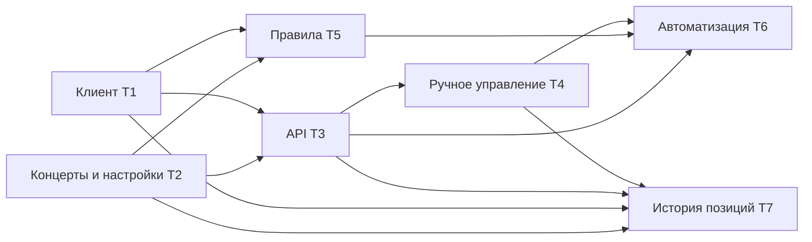

# План реализации MagicSEO

Канонический результат plan/1: [magicseo-task-v2.json](../../plans/magicseo-task-v2.json). Семь задач по одному модулю или сквозному экрану, четыре волны, ориентир каждой задачи — 60 минут. Существующие `PLAN.md` и `plan.json` сохранены как входные материалы; новая версия их не перезаписывает.

> [!IMPORTANT]
> Это результат планирования. Продуктового кода, установленного MagicSEO-плагина и выполненной проверки живого интерфейса пока нет. Платные операции не выполнялись; секреты не извлекались.

## Волны и владение

| Волна | Задача | Результат | Решения |
| --- | --- | --- | --- |
| 1 | T1 | Клиент кабинета, зависимости и проверка остановки | D6, D7 |
| 1 | T2 | Концерты, настройки сайтов, регионы и часовые пояса | D5, D6, D7, D8 |
| 2 | T3 | Серверное API BB, Env Catalog, иерархия и аудит | D1, D6, D7 |
| 2 | T5 | Чистые правила 48 часов и исполнитель с dry-run | D1, D2, D3, D4, D6, D8 |
| 3 | T4 | Сквозной экран ручного управления проектами | D1, D6, D7 |
| 4 | T6 | Редактор сайтов, предпросмотр, расписание и журнал | D2–D8 |
| 4 | T7 | Сбор и просмотр истории позиций | D1, D6, D7 |

В каждой волне `owns_paths` не пересекаются. Изменение общего `server.ts` заканчивается в T3: последующие задачи заполняют отдельные адаптеры RPC/расписаний. Изменение оболочки `app.tsx` заканчивается в T4: T6 и T7 заменяют свои вкладки. Права на файлы адаптеров и вкладок передаются между волнами явно. Задачи T6/T7 читают созданные ранее файлы, но не редактируют общую оболочку.

`read_first` содержит существующие исходные материалы, образцы и результаты предыдущих зависимостей. Создаваемые файлы перечислены в `files[]`/`expected_outputs`; отсутствующий новый файл не выдается за материал для чтения. Перед dispatch в worktree PM переносит эти материалы и каталог `contracts-v2` вместе с планом: проверка не должна читать другой checkout по абсолютному пути.

## Принятые свободные решения

- Сервис API — TypeScript backend плагина с аутентифицированным RPC BB. Отдельный HTTP-демон и собственное хранилище токенов не нужны. Чистый клиент можно использовать отдельно через его публичные методы.
- Хранилище — BB plugin KV. Мутации: максимум 500 записей; события автоматизации: максимум 200 на сайт. История позиций разбивается на шарды по размеру UTF-8; каждый JSON меньше 262144 байт.
- Автоматизация проверяет срок каждую минуту. История позиций собирается раз в 6 часов; между проектами предусмотрена пауза 1 секунда. Известный дедлайн остановки не откладывается на получасовой интервал опроса.
- Старт регулярного продвижения включает `autolaunch.active` и читает подтверждение. Разовый `POST /job` — отдельное ручное действие. Остановка выключает автопилот, отменяет текущий job и проверяет результат; ошибка тела ответа не считается подтверждением отмены.
- Новые сайты используют dry-run. `newProject: null` блокирует создание с причиной `new_project_settings_missing`. Значения provider/device/budget/target исполнитель не выбирает.
- Для нескольких концертов решает ближайший будущий старт: 49 часов — запуск; ровно 48 часов — остановка; после начала этого концерта решает следующий будущий концерт. Баланс не является входом правила.
- Проданный или перенесённый концерт дает `special_event_policy_pending` для своего города до решения владельца. Это временная блокировка, а не выбранная политика продвижения.
- Публичный WP feed читается без учетных данных. При необходимости учетная запись передаётся из Env Catalog в память и используется только для GET.
- Формат импортируемого CSV сверяется с кабинетом. Неизвестный шаблон блокирует импорт: одной записи в старом плане недостаточно, чтобы считать формат подтверждённым.

## Проверки и состояние базы

Проверяющие программы написаны планировщиком до dispatch:

- [check.mjs](contracts-v2/check.mjs) — неизменяемые black-box проверки функций, затем только тесты файлов соответствующей задачи.
- [ui.contract.test.tsx](contracts-v2/ui.contract.test.tsx) — настоящий navPanel через публичный SDK test harness, вызовы RPC, EN/RU и редактирование ошибок с искусственным секретным маркером.
- [vitest.config.mjs](contracts-v2/vitest.config.mjs) — конфигурация для явно названных UI-файлов; полный набор тестов проекта не запускается.
- [base-receipt.json](contracts-v2/base-receipt.json) — команды и фактические результаты на базе.

Все семь команд запускаются существующим Node 26.3.1 и завершаются кодом 1 с `RED Tn: implementation_missing:<owned path>`. Это feature-проверки: после появления модуля тот же исполняемый код проверяет его поведение, а не только наличие файла. Текущая база не закрывает ни одну задачу. Парсер Node принял `check.mjs`; TypeScript принял синтаксис UI-проверок. Импорты и выполнение UI пока не проверены: реализация и зависимости будут созданы задачами. Структурная проверка подтвердила D1–D8, собственность результатов, отсутствие конфликтов `never_touch`, материалы предыдущих волн и направление зависимостей.

Проверки разных задач не запускают общий build/typecheck. После интеграции каждой партии PM выполняет `npm run typecheck` и `bb plugin build .` с ожидаемым кодом 0. Перед browser QA требуется установка/перезагрузка собранного плагина в BB. В UI-волнах есть `[UI-observable] qa_cases`, включая ширины 390/1200, EN/RU, Pokecut/Default light/dark. Живые мутации в этих проверках подменяются фикстурами; чтение кабинета проверяется отдельно.

> [!NOTE] Совместимость метаданных
> Пользователь требует верхнеуровневое поле `covers` в каждой задаче. Оно сохранено. В локальном checkout схемы Lane Pilot этого поля нет; остальная форма проверена по этой схеме. Вызывающий граф должен сохранить покрытие и при необходимости отделить это метаданное перед старым dispatch. Изменять Lane Pilot в этой фазе запрещено. Адрес QA указывает на корень существующего BB; сценарий сам открывает панель MagicSEO после установки, адрес не выдается за уже развернутый экран.

## Исключено и передано дальше

| Что | Причина и следующий шаг |
| --- | --- |
| Значения настроек продвижения новых проектов | Deferred в CONTEXT.md. Владелец выбирает до платного создания; код поддерживает явно переданную конфигурацию, без значений по умолчанию. |
| Политика sold-out и переносов | Deferred. Пока видна причина блокировки для города. |
| Формат экспорта и получатели отчетов | Deferred. T7 дает таблицу/внутренние JSON-строки; CSV/Excel/PDF, публичные ссылки и отправка не входят. |
| Платежи, пополнения, перевод денег, доступы и админские операции | Не нужны описанному циклу; финансовые действия запрещены no-gos. |
| Поддержка, referrals, competitors и help | В этой фазе клиент ограничен перечисленными в цели проектами, ключами, продвижением, позициями и балансом; весь вспомогательный кабинет не воспроизводится. |
| Смена скомпрометированного пароля | SECURITY.md требует смены. Это действие владельца; до включения live надо обновить `MAGICSEO_LOGIN` через защищённый Env Catalog. |
| Контролируемая живая проверка отмены/запуска и импорт-шаблона | Требует выбранного проекта и согласованного платного действия; фиктивные тесты не доказывают семантику непроверенных мутаций кабинета. |
| Выпуск, установка, GitNexus и project life | Интеграционные обязанности PM после принятия кода. Текущему планировщику разрешены только phase/plans и chat-артефакты; чужие файлы, commit и push не выполнялись. |

После реализации PM публикует компонент в публичном репозитории владельца, обновляет GitNexus и карточку/реестр проекта, устанавливает/перезагружает плагин и сохраняет фактические результаты живых проверок. Это не выполнено на этапе планирования.

## Исправление замечаний к read_first

Пять замечаний из `gaps.28e71fbb.json` объединены одной причиной: T1, T3, T4, T6 и T7 ссылались на внешние образцы абсолютными путями. Все 11 внешних образцов скопированы байт-в-байт в [references](references/manifest.json); манифест хранит исходный путь относительно BB-сервис, размер и SHA-256. Контракты теперь читают снимки по проектным путям без `..`. Исходные плагины и документы не редактировались.

Это исправление планировщика, дополнительная задача исполнителю не требуется. В worktree нужно переносить каталог `references/` вместе с остальными материалами фазы. Состав семи задач, четыре волны, покрытие D1–D8 и границы deferred сохранены. Результат проверки путей, владения и снимков: [path-repair-receipt.json](contracts-v2/path-repair-receipt.json).
